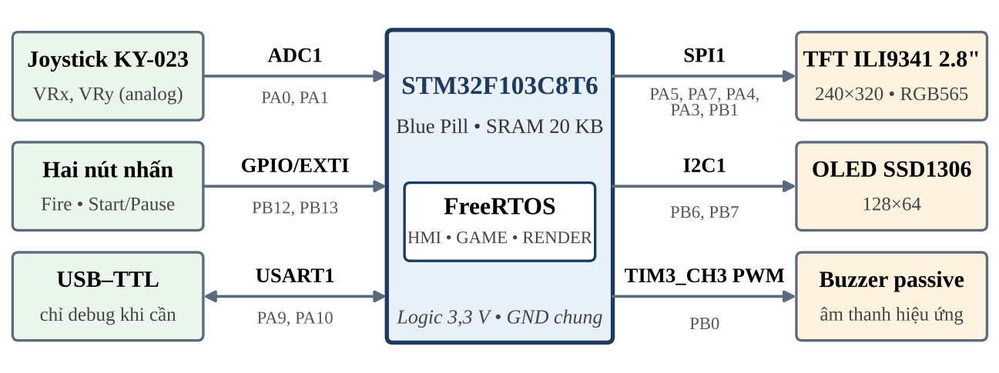

# Game bắn gà STM32 / FreeRTOS

Đề tài: **Hệ thống đồ họa thời gian thực trên vi điều khiển STM32 sử dụng FreeRTOS – ứng dụng game bắn gà**.

**Trạng thái: khung khởi tạo để nhóm bắt đầu phát triển, chưa phải game chạy trên kit.** Build đã kiểm tra với ARM GCC 14.2.1. BSP và HAL đang trả về `HAL_NOT_IMPLEMENTED`; ba task là khung chức năng. `main.c` dừng ở bước BSP để không chạy một cấu hình phần cứng chưa hoàn thiện. Không có release/tag sản phẩm.

## Đọc trước khi làm

1. [Quy trình Git của nhóm](docs/GIT_WORKFLOW.md): nhánh, PR, review, tích hợp và release.
2. [Phân công và đầu việc](docs/PLAN.md): ba thành viên, nhánh và điều kiện hoàn thành từng giai đoạn.
3. [Phần cứng và chân kết nối](docs/HARDWARE.md).
4. [Kiến trúc, API và IPC](docs/ARCHITECTURE.md).
5. [Hướng dẫn build](docs/BUILD.md), [kế hoạch kiểm thử](docs/TEST_PLAN.md).
6. [Nguồn yêu cầu và các giả định](docs/REQUIREMENTS.md).

## Phạm vi đề tài

- STM32F103C8T6 (Flash 64 KiB, SRAM 20 KiB), TFT ILI9341 240×320 qua SPI1.
- OLED SSD1306 128×64 qua I2C1; joystick ADC1; hai nút Fire và Start/Pause.
- Buzzer thụ động TIM3_CH3; USART1 tùy chọn để debug.
- Ba task: HMI, GAME, RENDER; GAME cập nhật 20 ms và là nơi duy nhất ghi game state.
- FSM: MENU, PLAYING, PAUSED, GAME_OVER. Queue + Task Notification cho IPC.
- Không dùng framebuffer RGB565 toàn màn hình (153.600 byte). TFT: hai buffer nhỏ tổng 2.560 byte; OLED: 1.024 byte. Đo FPS thực tế, không cam kết FPS trước khi đo.



## Cấu trúc

```text
bsp/                 board, pin map, startup (leader phụ trách)
hal/inc/             API đã thống nhất cho SPI, I2C, ADC, GPIO, PWM, UART
hal/src/             stub để từng thành viên triển khai driver
middlewares/         FreeRTOS V11.1.0, GCC ARM_CM3, heap_4, giấy phép MIT
app/inc/             app_cfg, game_types, IPC, API tạo task
app/src/             IPC ban đầu, hooks, khung HMI / GAME / RENDER
config/              FreeRTOSConfig.h (chỉ leader thay đổi)
linker/              Flash 64 KiB / RAM 20 KiB, chừa 1 KiB MSP
main.c               điểm tích hợp (không sửa trong nhánh task)
docs/                hướng dẫn, phân công, tiêu chí nghiệm thu, tài liệu gốc
.github/             CI build và mẫu Pull Request
scripts/             đưa kho Git lên remote trống
```

## Bắt đầu

```sh
git switch develop
make -j2 check
```

Cần `arm-none-eabi-gcc`, Binutils, Newlib và Make. Trong môi trường đám mây hiện tại:

```sh
export PATH=/workspace/toolchains/arm/usr/bin:$PATH
```

Build tạo `build/firmware.elf`, `.bin`, `.hex`, `.map`; tất cả bị Git bỏ qua. CI mới kiểm tra biên dịch/liên kết, không thay thế kiểm thử kit.

## Các nhánh ban đầu

- `main`: commit bootstrap theo bước setup của tài liệu thầy; **chưa đạt tiêu chí production**. Sau bootstrap, cấm commit trực tiếp.
- `develop`: nhánh làm việc chung; có API HAL/IPC và khung task ban đầu.
- `feature/hal-spi-tft`: thành viên 1.
- `feature/hal-adc-gpio`: thành viên 2.
- `feature/hal-i2c-pwm`: thành viên 3, UART debug tùy chọn do nhóm phân công thêm.

Ba nhánh feature được tạo từ cùng `develop`. Chưa tạo nhánh task hoặc integration vì HAL chưa được kiểm tra/merge; lệnh tạo nằm trong quy trình. Không dựng lịch sử merge hoặc kết quả test giả.

Chưa có tên/GitHub username của ba thành viên; tài liệu dùng TV1/TV2/TV3 để nhóm điền. Chưa áp dụng branch protection trên GitHub khi chưa có remote/quyền quản trị.
