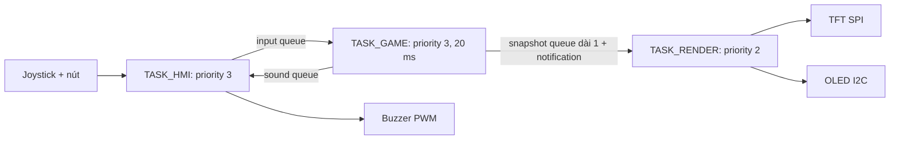

# Kiến trúc và hợp đồng API

## Phân lớp

`BSP -> HAL/Drivers -> APP`. BSP giữ startup/clock/pin map. HAL che giấu thanh ghi và quy định timeout. Driver ILI9341/SSD1306 sẽ được thêm trong `hal/inc` / `hal/src` trên feature của người phụ trách. APP chỉ gọi API, không ghi trực tiếp thanh ghi trong task.

TASK_GAME là nơi duy nhất sửa game state; RENDER chỉ nhận bản sao. GAME cập nhật chuyển động/va chạm bằng `vTaskDelayUntil` mỗi 20 ms, kết hợp đọc sự kiện. Không block chờ input vô hạn làm ngừng chuyển động.

## Task API

Mỗi task có `task_xxx_create()` trả về `BaseType_t`. Hàm entry là `static`; cấp stack theo **words**, kiểm tra `pdPASS`. Hiện tại entry chỉ là khung chờ/chu kỳ, chưa có game engine hoặc driver hoạt động. Không sửa `main.c` trong nhánh task. Test độc lập bằng harness riêng trên nhánh feature, dùng mock queue/dummy data, không đưa harness vào điểm tích hợp chung.

## IPC

| Đối tượng | Hướng / kiểu | Quy tắc |
|---|---|---|
| `g_input_queue` | HMI -> GAME / `app_event_t` | 16 phần tử ban đầu; nhánh HMI/GAME thống nhất khi đầy: đếm drop, MOVE có thể gộp, SHOOT/PAUSE không bị bỏ âm thầm |
| `g_sound_queue` | GAME -> HMI / `app_sound_t` | 8 phần tử; hiệu ứng không block GAME; đếm drop nếu đầy |
| `g_render_queue` | GAME -> RENDER / `game_snapshot_t` | Dài 1; `xQueueOverwrite` bản sao mới nhất |
| `g_render_task` | GAME notify RENDER | Gửi sau snapshot; notification được gộp; không có nghĩa mỗi notify tương ứng một frame |

`app_ipc_init()` được gọi một lần trước tạo task, kiểm tra lỗi cấp phát, dọn các queue đã tạo nếu lỗi. `app_render_publish()` chỉ gọi từ GAME sau khi RENDER được tạo. RENDER nhận notification rồi lấy snapshot, không giữ con trỏ vào state chung.

Snapshot hiện chỉ có state/score/player_x/hp; nhóm cần PR API thêm dữ liệu gà/đạn/dirty rectangles trước khi triển khai đồ họa. Nếu bỏ qua nhiều snapshot, RENDER so sánh với **khung cuối thực sự đã vẽ** hoặc redraw đầy đủ bằng các strip nhỏ; không chỉ vẽ delta của snapshot bị mất.

Các hàm từ task dùng API thường; ISR chỉ dùng `...FromISR()` kèm yield khi cần. Không gọi `app_render_publish` từ ISR. Nếu cần bus mutex, dùng priority inheritance của FreeRTOS và timeout hữu hạn, không tự thay bằng spinlock. Chưa có mutex bus trong stub; driver phải bổ sung khi implement.

## HAL

Header trong `hal/inc` là hợp đồng ban đầu. SPI/I2C/UART và ADC có timeout theo ms; 0 nghĩa không chờ. Không dùng `portMAX_DELAY` để lẩn tránh timeout. Trả mã lỗi; không trả HAL_OK khi thao tác chưa thực hiện. Stub hiện trả `HAL_NOT_IMPLEMENTED`.

- SPI: khóa cả giao dịch CS/DC + payload trong driver màn hình, không chỉ từng byte. Không gọi SPI đồng thời từ task khác nếu chưa có mutex transaction.
- I2C: địa chỉ 7-bit chưa shift, có xử lý NACK/bus busy/timeout.
- ADC: hai giá trị 12-bit, HMI làm calibration/dead-zone.
- GPIO: bit 0 Fire, bit 1 Start/Pause, logic pressed; chống dội không delay trong ISR.
- PWM: freq_hz=0 tắt buzzer; hiệu ứng theo thời gian task, không busy-wait.
- DMA tùy chọn; khi thêm phải thống nhất buffer ownership và completion FromISR.

## FSM cần triển khai ở nhánh GAME

| State | Event hợp lệ | State sau / xử lý |
|---|---|---|
| MENU | START hoặc nút START_PAUSE | PLAYING, khởi tạo ván |
| PLAYING | MOVE_LEFT / MOVE_RIGHT / SHOOT | PLAYING, cập nhật input |
| PLAYING | PAUSE hoặc START_PAUSE | PAUSED |
| PLAYING | HIT / LOSE_HP | Cập nhật điểm / HP; HP về 0 -> GAME_OVER |
| PLAYING | GAME_OVER | GAME_OVER |
| PAUSED | RESUME hoặc START_PAUSE | PLAYING, không nhảy chuyển động do thời gian đã pause |
| GAME_OVER | RESTART hoặc START_PAUSE | PLAYING, reset ván |

Event không hợp lệ bị bỏ qua có kiểm soát. Quy tắc nút START_PAUSE theo state là lựa chọn khởi đầu cần nhóm thống nhất, không phải kết quả test. Hàm chuyển state chưa được triển khai trong kho khung.

## Ngân sách RAM

SRAM tối đa 20 KiB. Framebuffer 240×320×2 = 153.600 B không phù hợp.

| Thành phần | Ngân sách ban đầu |
|---|---:|
| Heap FreeRTOS (gồm task stack/TCB/queue cấp phát động) | 10.240 B |
| Stack HMI / GAME / RENDER | 192 / 256 / 384 words, nằm **trong heap**, không cộng lần hai |
| Idle stack | 128 words, nằm trong heap |
| Hai buffer TFT | 2 × (320 pixel × 2 dòng × 2 B) = 2.560 B, chưa cấp trong stub |
| Buffer OLED | 1.024 B, chưa cấp trong stub |
| MSP / ISR stack dự trữ | 1.024 B |
| Còn lại | Globals kernel/driver/game state, alignment và margin |

Buffer tối đa 320 pixel/line cho phép chọn portrait/landscape sau này; chiều rộng thực phải thống nhất với orientation. Không cấp hai framebuffer toàn màn hình. Linker assert không lấn vùng MSP; `.main_stack` nằm ở đỉnh RAM nên `--print-memory-usage` có thể báo RAM 100% do khoảng trống giữa `.bss` và stack: đọc địa chỉ `_ebss`, `.main_stack`, bảng `size` và map để tính dung lượng thật.

Khi nghiệm thu: ghi `xPortGetMinimumEverFreeHeapSize()`, `xPortGetFreeHeapSize()` và high-water mark mỗi task, cộng buffer thực và margin stack ISR. Heap/stack/FPS ban đầu chưa được đo. Không gọi printf/newlib đồng thời nếu chưa có thiết kế an toàn RTOS và ngân sách.
