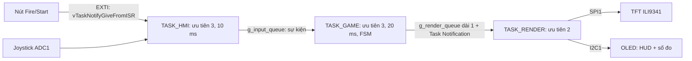
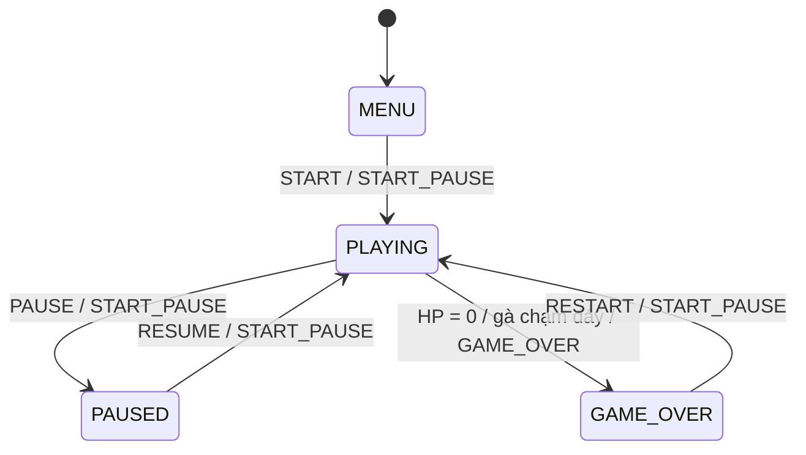

# Kiến trúc và hợp đồng API

## Phạm vi

Ba ngoại vi chính theo đề cương: **SPI1** (TFT ILI9341), **I2C1** (OLED SSD1306), **ADC1** (joystick). GPIO + EXTI dùng cho hai nút và chân điều khiển TFT. Đã bỏ khỏi phạm vi: buzzer PWM (TIM3), UART debug, DMA. Chủ đề mở rộng (mục 6 của plan): **State machine, event-driven firmware**.

## Phân lớp

`BSP -> HAL/Drivers -> APP`. BSP giữ startup/clock/pin map. HAL che giấu thanh ghi và quy định timeout. APP chỉ gọi API, không ghi trực tiếp thanh ghi trong task.

## Task

Mỗi task có `task_xxx_create()` trả về `BaseType_t`, tự gán handle (`g_hmi_task`, `g_game_task`, `g_render_task`) để đo stack. Stack tính theo **words**. Không sửa `main.c` trong nhánh task. Logic FSM/game tách khỏi RTOS (`game_engine.c`) để unit test trên PC.

| Task | Ưu tiên | Nhịp | File | Việc chính |
|---|---|---|---|---|
| HMI | 3 | 10 ms + đánh thức bởi EXTI | `task_hmi.c` | ADC joystick (tâm, vùng chết, tốc độ 0..4), chống dội nút, auto-fire, gửi sự kiện |
| GAME | 3 | 20 ms `xTaskDelayUntil` | `task_game.c`, `game_engine.c` | FSM, gà/đạn/trứng, va chạm, điểm, HP, đợt |
| RENDER | 2 | theo notification (timeout 100 ms) | `task_render.c`, `render_tft.c`, `oled_view.c` | TFT vùng bẩn, OLED 10 Hz, đo FPS/heap/stack mỗi 1 s |

## State machine, event-driven firmware

Firmware hướng sự kiện: nút nhấn sinh ngắt EXTI -> ISR chỉ đánh thức HMI bằng `vTaskNotifyGiveFromISR` -> HMI chống dội và tạo **sự kiện** (`app_event_t`) gửi qua queue -> GAME đưa sự kiện vào **FSM**. Song song, GAME vẫn cập nhật định kỳ 20 ms (gà, đạn, trứng) — sự kiện không thay thế vòng cập nhật định kỳ. GAME là nơi duy nhất ghi game state; RENDER chỉ nhận bản sao qua queue + Task Notification.

### Bảng chuyển trạng thái (`game_engine.c`)

| Trạng thái | Sự kiện hợp lệ | Trạng thái sau / xử lý |
|---|---|---|
| MENU | START, START_PAUSE | PLAYING, khởi tạo ván mới |
| PLAYING | MOVE_LEFT, MOVE_RIGHT, SHOOT | PLAYING, cập nhật tốc độ / bắn (có cooldown) |
| PLAYING | PAUSE, START_PAUSE | PAUSED |
| PLAYING | HIT, LOSE_HP | Cập nhật điểm / HP; HP về 0 -> GAME_OVER |
| PLAYING | GAME_OVER | GAME_OVER |
| PAUSED | RESUME, START_PAUSE | PLAYING, không bù thời gian đã dừng |
| GAME_OVER | RESTART, START_PAUSE | PLAYING, reset ván |

Mọi cặp (trạng thái, sự kiện) khác bị bỏ qua và đếm vào `ignored_events`. HIT/LOSE_HP/GAME_OVER do engine tự sinh khi va chạm (trúng gà, trúng trứng, gà xuống tới tầng người chơi), vẫn nhận từ queue để kiểm thử.

Kiểm chứng: `tests/host/test_engine.c` duyệt **đủ 44 ô** (4 trạng thái × 11 sự kiện) so với bảng trên, cùng các kịch bản pause không làm game chạy tiếp, mất máu -> GAME_OVER, restart, đợt mới và 200.000 khung ngẫu nhiên.

## IPC

| Đối tượng | Hướng / kiểu | Quy tắc |
|---|---|---|
| EXTI -> HMI | `vTaskNotifyGiveFromISR` | ISR chỉ ghi cạnh + đánh thức; chống dội trong task |
| `g_input_queue` | HMI -> GAME / `app_event_t` | 16 phần tử, gửi không chờ. Đầy: MOVE bị bỏ và đếm `input_drops` (HMI gửi lại tốc độ mỗi 250 ms); SHOOT/START_PAUSE giữ cờ và gửi lại chu kỳ sau, đếm `input_retries` |
| `g_render_queue` | GAME -> RENDER / `game_snapshot_t` | Dài 1; `xQueueOverwrite` bản sao mới nhất |
| `g_render_task` | GAME notify RENDER | Sau snapshot; notification được gộp |
| Mutex trong HAL | SPI, I2C, ADC | Khóa bus có timeout hữu hạn, priority inheritance |

### Snapshot v2 (`game_types.h`)

`state, score, frame, player_x, hp, wave, flags, formation_x/y, chicken_alive (bitmask 18 con), bullets[6], eggs[6], booms[4]` — 92 byte, không con trỏ. Vị trí gà suy ra từ góc đội hình + chỉ số hàng/cột. Ô trống có `x = GAME_POS_NONE`.

### Vẽ TFT không framebuffer

1. Vùng bẩn: với mỗi gà/đạn/trứng/nổ/tàu, hợp chữ nhật vị trí cũ (đã vẽ) và mới. Đổi trạng thái/đợt hoặc > 64 vùng -> vẽ toàn màn.
2. Mỗi vùng: `ili9341_begin()` mở cửa sổ, ghép từng dải tối đa 640 pixel trong **một bộ đệm 1.280 B**: nền sao (băm tọa độ, không tốn RAM) -> sprite -> hộp chữ -> chữ, rồi gửi bằng SPI polling. Mỗi pixel ghi một lần với màu cuối: không nhấp nháy.
3. RENDER so với **khung đã vẽ thực sự** (`s_drawn`), nên khi notification bị gộp vẫn không sót vết.

Ước lượng lưu lượng: trung bình ~3,4 KB/khung PLAYING (~1,5 ms SPI ở 18 MHz), tối đa ~14,6 KB (~6,5 ms); vẽ toàn màn 153,6 KB (~68 ms) chỉ khi đổi màn hình. Polling đủ nhanh nên không cần DMA.

## HAL

Mọi timeout tính bằng ms, hữu hạn; trả mã lỗi, không trả HAL_OK khi chưa thực hiện. Driver đọc clock thực từ RCC (`hal_sys`).

- BSP: HSE 8 MHz × 9 = 72 MHz (dự phòng HSI 64 MHz), APB1 36 MHz, ADC 12 MHz, Flash 2 WS, NVIC 4 bit preempt, DWT đo chu kỳ, LED PC13. `configCPU_CLOCK_HZ = SystemCoreClock`.
- SPI1 (TV1): master chỉ truyền, mode 0, 18 MHz, polling. `hal_spi_lock/unlock` khóa cả giao dịch CS/DC + payload.
- ILI9341 (TV1): `begin/push/end`, `fill_rect`, `blit`. MADCTL cấu hình bằng macro. Init dùng `vTaskDelay` khi scheduler chạy.
- I2C1 (TV3): 400 kHz polling, mutex, NACK/timeout/khôi phục bus. SSD1306: bộ đệm 1 KiB, chỉ gửi page có pixel đổi. `oled_view`: HUD + số đo.
- ADC1 (TV2): hai kênh 12 bit, mutex, timeout. GPIO: bit 0 Fire, bit 1 Start/Pause, EXTI15_10 ưu tiên 6.

Ngắt duy nhất gọi API FreeRTOS là EXTI15_10, ưu tiên số 6 ≥ `configLIBRARY_MAX_SYSCALL_INTERRUPT_PRIORITY` (5), kiểm tra bằng `#error` lúc biên dịch.

## Ngân sách RAM

SRAM tối đa 20 KiB. Framebuffer 240×320×2 = 153.600 B không phù hợp.

| Thành phần | Ngân sách ban đầu |
|---|---:|
| Heap FreeRTOS (gồm task stack/TCB/queue cấp phát động) | 10.240 B |
| Stack HMI / GAME / RENDER | 192 / 256 / 384 words, nằm **trong heap**, không cộng lần hai |
| Idle stack | 128 words, nằm trong heap |
| Hai buffer TFT | 2 × (320 pixel × 2 dòng × 2 B) = 2.560 B, chưa cấp trong stub |
| Buffer OLED | 1.024 B, chưa cấp trong stub |
| MSP / ISR stack dự trữ | 1.024 B |
| Còn lại | Globals kernel/driver/game state, alignment và margin |

Buffer tối đa 320 pixel/line cho phép chọn portrait/landscape sau này; chiều rộng thực phải thống nhất với orientation. Không cấp hai framebuffer toàn màn hình. Linker assert không lấn vùng MSP; `.main_stack` nằm ở đỉnh RAM nên `--print-memory-usage` có thể báo RAM 100% do khoảng trống giữa `.bss` và stack: đọc địa chỉ `_ebss`, `.main_stack`, bảng `size` và map để tính dung lượng thật.

Khi nghiệm thu: ghi `xPortGetMinimumEverFreeHeapSize()`, `xPortGetFreeHeapSize()` và high-water mark mỗi task, cộng buffer thực và margin stack ISR. Heap/stack/FPS ban đầu chưa được đo. Không gọi printf/newlib đồng thời nếu chưa có thiết kế an toàn RTOS và ngân sách.
