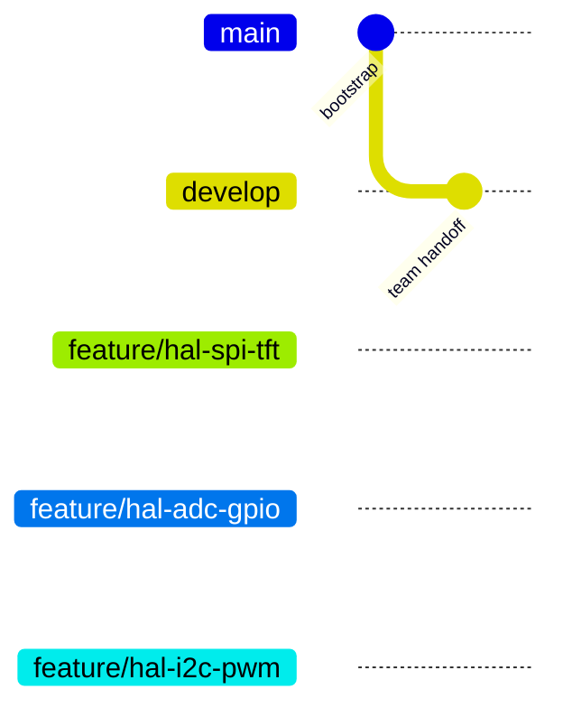

# Quy trình Git của nhóm

Áp dụng PDF của thầy và sơ đồ main/develop/ngoại vi/task trên bảng. Các tên Sensor/Display/Comm trong PDF là ví dụ: dự án này dùng HMI/GAME/RENDER.

## 1. Nhánh và trách nhiệm

| Nhánh | Vai trò | Nguồn / đích |
|---|---|---|
| `main` | Sau bootstrap chỉ chứa bản đã chạy ổn trên kit | PR release từ develop; cấm commit trực tiếp |
| `develop` | Tích hợp chung | Nhận PR feature và integration |
| `feature/<ten-task>` | Công việc của thành viên | Tạo từ develop mới nhất, PR về develop |
| `integration/system-v1` | Ghép hệ thống sau khi có đủ task | Tạo từ develop, test kit rồi PR về develop |

PDF cho phép commit khung ban đầu lên main rồi tạo develop. Kho hiện ở bước đó: **main bootstrap chưa phải bản production đã kiểm tra kit**. Không tạo tag v1.0.0 cho bootstrap.



Sơ đồ trên là trạng thái khởi tạo; phần task/integration là kế hoạch phía dưới, chưa giả định đã thực hiện merge.

## 2. HAL — ba nhánh đã tạo từ develop

TV1: `feature/hal-spi-tft`; TV2: `feature/hal-adc-gpio`; TV3: `feature/hal-i2c-pwm`.

Sau khi remote được đưa lên:

```sh
git fetch origin
git switch feature/hal-spi-tft  # thay bằng nhánh mình phụ trách
git pull --ff-only origin feature/hal-spi-tft
# viết driver đúng API, build và test trên kit
git add hal/ docs/
git commit -m "feat(hal-spi): implement ILI9341 rectangle transfer"
git push -u origin feature/hal-spi-tft
```

Mở PR vào develop. Thành viên khác review API, mutex/timeout, deadlock, pin/clock và test. Leader merge lần lượt. Không sửa file người khác phụ trách nếu chưa thống nhất.

## 3. Task — chỉ tạo sau khi HAL/RTOS đã hoàn tất

```sh
git switch develop
git pull --ff-only origin develop
git switch -c feature/task-hmi
```

Tương tự: `feature/task-game`, `feature/task-render`, nhánh hỗ trợ `feature/oled-view-tests`. TV2 làm HMI/GAME theo kế hoạch, không dùng một branch chung cho nhiều người cùng force-push. Mỗi task ở app/src/task_xxx.c và app/inc/task_xxx.h; không sửa main.c. Test độc lập bằng harness/mock queue trước khi PR về develop.

Trong lúc làm, đồng bộ branch cá nhân:

```sh
git fetch origin
git switch feature/task-hmi
git rebase origin/develop
# nếu conflict: sửa file, git add <file>, git rebase --continue
# cần quay lại trước rebase: git rebase --abort
# chỉ sau rebase nhánh cá nhân đã push:
git push --force-with-lease origin feature/task-hmi
```

Không rebase/force-push main hoặc develop, không force-push nhánh người khác đang dùng.

## 4. Integration và release

Sau khi ba task đã merge develop:

```sh
git switch develop
git pull --ff-only origin develop
git switch -c integration/system-v1
```

Đại diện ghép HAL -> IPC -> task -> scheduler tại main.c/app_ipc.c, kiểm tra đầy đủ TEST_PLAN, heap/stack/FPS. Commit fix trên integration branch, push và mở PR integration -> develop. Chọn **Create a merge commit** (`--no-ff`) để giữ rõ nhánh trên đồ thị.

Khi kit ổn định, mở PR `develop -> main`, review bằng chứng test rồi merge. Trên máy leader:

```sh
git switch main
git pull --ff-only origin main
git tag -a v1.0.0 -m "Release v1.0.0: STM32 FreeRTOS chicken shooter validated on kit"
git push origin v1.0.0
```

Không merge trực tiếp vào main để né branch protection. Sau khi nhánh integration đã merge và không còn việc, có thể xóa nhánh đó; không xóa nhánh đang làm.

## 5. Quy tắc bắt buộc

- Một người phụ trách pin/clock/codegen/FreeRTOSConfig.h; hiện dùng Make, không có .ioc để mỗi người generate riêng.
- ISR dùng ...FromISR, đúng NVIC priority; task dùng vTaskDelay/vTaskDelayUntil, không HAL_Delay/delay_ms.
- Commit: `feat(task-hmi): ...`, `feat(hal-spi): ...`, `fix(rtos): ...`, `refactor(render): ...`; không commit build, IDE cá nhân hoặc secret.
- Mỗi PR ghi rõ đã/chưa test kit; task tạo thành công, không tràn stack, build không warning. Người khác review trước merge.
- Không dùng một commit hoặc tài khoản để giả thành lịch sử đóng góp của ba người.

## 6. GitHub cần cấu hình sau khi tạo remote

Leader thêm ba tài khoản vào repository và điền tên vào PLAN. Trong Settings -> Rules/Branches tạo rule cho main và develop:

- Require pull request before merging, tối thiểu một approval; dismiss stale approvals khi có commit mới.
- Require status check `build` của workflow `firmware` sau khi workflow chạy lần đầu.
- Không cho force push hoặc xóa main/develop; yêu cầu resolve conversations.
- Nếu gói GitHub hỗ trợ, chặn bypass và giới hạn merge vào main cho leader; kiểm tra quyền trong private repo theo gói tài khoản.

Đây là **hướng dẫn cần áp dụng**, chưa phải rule đã bật. Workflow YAML/PR template trong source không tự bật branch protection. Test kit vẫn là bước review thủ công, CI không xác nhận phần cứng.

## 7. Đưa kho cục bộ lên GitHub

Tạo repository trống trong đúng tài khoản, chọn private/public theo nhóm; không thêm README/license/.gitignore tự động. Trong thư mục kho đã giải nén (có .git):

```sh
bash scripts/publish.sh https://github.com/nhudaohaidang-glitch/stm32-freertos-chicken-shooter.git
```

Script chỉ push main/develop và ba nhánh HAL, không force, không xóa remote, không tạo tag. Kho remote đã có commit thì script dừng để tránh nhập lịch sử ngoài ý muốn; xử lý bằng review riêng. Nếu Git không có quyền push, đăng nhập GitHub bằng công cụ chính thức trên máy của nhóm; không ghi token vào README/remote hoặc gửi token trong chat.

Nếu chỉ có `.bundle`, khôi phục đủ nhánh trước khi publish:

```sh
git clone -b develop stm32-freertos-chicken-shooter.bundle stm32-freertos-chicken-shooter
cd stm32-freertos-chicken-shooter
git branch main origin/main
for branch in feature/hal-spi-tft feature/hal-adc-gpio feature/hal-i2c-pwm; do
  git branch "$branch" "origin/$branch"
done
git remote remove origin
```

Bundle là bản dự phòng lịch sử Git; ZIP có sẵn .git dùng trực tiếp, không khởi tạo lại bằng git init nếu muốn giữ nhánh/commit.
